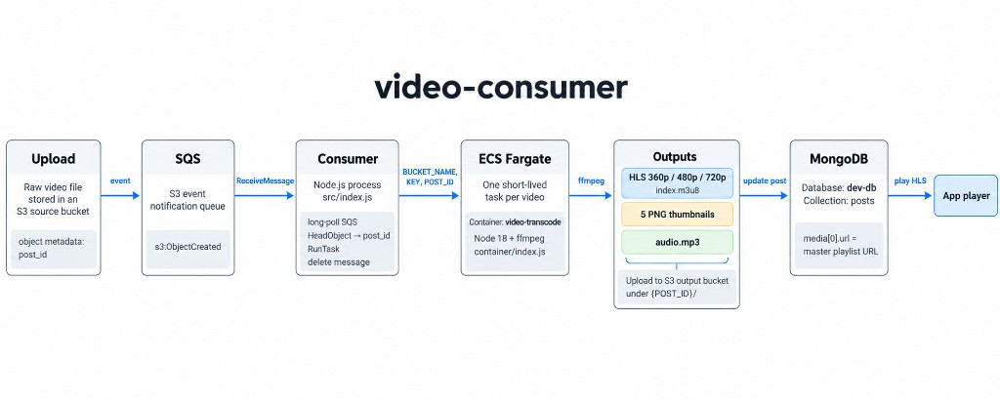

# video-consumer

Video pipeline for a post-based app. A user uploads a raw video to S3; this service turns that file into a streamable package and attaches it back to the post that owns it.

Uploads land in a source bucket with `post_id` stored as object metadata. S3 notifies an SQS queue. A long-running consumer reads those events and starts one ECS Fargate task per video. The task runs ffmpeg in a container: it builds an adaptive HLS ladder (360p, 480p, 720p), five preview thumbnails, and an MP3 of the audio track, then uploads everything under that post id on an output bucket. After the master playlist is up, the worker updates the matching MongoDB document so the app can play `posts.media[0].url`.

The consumer and the transcoder are separate on purpose. Polling SQS is cheap and stays up. Transcoding is CPU-heavy and short-lived, so each video gets its own Fargate task and exits when the upload finishes. One bad file does not take down the poller.

Region is `ap-south-1`. The database is `dev-db`, collection `posts`. The player sample in `index.html` is only for checking a finished HLS URL in the browser.

## How it fits together



```
S3 upload (object metadata: post_id)
        │
        ▼
   SQS queue  ◄──  src/index.js  (long-poll, 1 message, 15s wait)
        │
        │  HeadObject → read metadata.post_id
        │  RunTask (Fargate) with BUCKET_NAME, KEY, POST_ID
        │  delete the SQS message
        ▼
ECS task: container/  (Node 18 + ffmpeg)
        │
        ├─ download source object
        ├─ 5 PNG thumbnails
        ├─ audio.mp3
        ├─ HLS 360p / 480p / 720p + master index.m3u8
        ├─ upload under {POST_ID}/ on the output bucket
        └─ posts.media = [{ url: .../hls/index.m3u8 }]
```

| Piece | Path | Role |
| --- | --- | --- |
| Consumer | `src/index.js` | SQS poller. Reads `post_id` from S3 object metadata and starts the Fargate task. |
| Transcoder | `container/index.js` | ffmpeg worker. Produces HLS, thumbnails, and MP3, uploads them, updates MongoDB. |
| Image | `container/Dockerfile` | `node:18-alpine` with `ffmpeg`. `CMD` is `npm start`. |
| Player sample | `index.html` | Local Video.js page for playing an HLS master playlist. |

## Processing steps

1. The consumer calls `ReceiveMessage` on `SQS_QUEUE_URL` (`MaxNumberOfMessages: 1`, `WaitTimeSeconds: 15`) and loops forever.
2. Each body is an S3 event notification. For every record it reads `bucket.name` and `object.key`.
3. `HeadObject` on that key returns user metadata. The worker uses `post_id`.
4. `RunTask` starts Fargate task definition `video-transcoder` on cluster `dev-transcoder`, container name `video-transcode`, with public IP enabled. Overrides:

   - `BUCKET_NAME` — source bucket
   - `KEY` — source object key
   - `POST_ID` — value from S3 metadata

5. The SQS message is deleted after the task is submitted.
6. Inside the container, ffmpeg writes:

   | Output | Settings |
   | --- | --- |
   | 360p | 480×360, 800k |
   | 480p | 858×480, 1400k |
   | 720p | 1280×720, 2800k |

   Video is `libx264`, audio in the HLS variants is AAC, segments are 6 seconds, playlist type is VOD. Five PNG screenshots and one `audio.mp3` (`libmp3lame`) are produced as well.

7. Uploads go to `S3_BUCKET_NAME`:

   ```
   {POST_ID}/hls/index.m3u8
   {POST_ID}/hls/playlist_360p.m3u8
   {POST_ID}/hls/playlist_480p.m3u8
   {POST_ID}/hls/playlist_720p.m3u8
   {POST_ID}/hls/segment_*.ts
   {POST_ID}/thumbnails/thumbnail_001.png … thumbnail_005.png
   {POST_ID}/audio/audio.mp3
   ```

8. After `index.m3u8` is uploaded, MongoDB database `dev-db`, collection `posts`, is updated:

   ```js
   { $set: { media: [{ url: "https://<S3_BUCKET_NAME>.s3.amazonaws.com/<POST_ID>/hls/index.m3u8" }] } }
   ```

   `_id` is `POST_ID` as an ObjectId.

`BUCKET_NAME`, `KEY`, and `POST_ID` are injected per task. `S3_CLIENT_*`, `MONGODB_URI`, and `S3_BUCKET_NAME` must already be on the ECS task definition. They are not set in the `RunTask` overrides.

## Layout

```
video-consumer/
├── src/index.js              # SQS consumer + ECS RunTask
├── package.json              # consumer dependencies
├── index.html                # Video.js HLS player sample
├── .env.example
└── container/
    ├── Dockerfile
    ├── index.js              # ffmpeg + S3 upload + Mongo update
    └── package.json          # transcoder dependencies
```

Consumer dependencies: `@aws-sdk/client-sqs`, `@aws-sdk/client-ecs`, `@aws-sdk/client-s3`, `dotenv`.

Transcoder dependencies: `@aws-sdk/client-s3`, `fluent-ffmpeg`, `mongodb`. The image installs the `ffmpeg` binary via Alpine.

## Setup

Node.js 18+.

```bash
npm install
cp .env.example .env
# fill in .env
node src/index.js
```

`dotenv` is listed in `package.json` and is not imported in `src/index.js`, so a `.env` file is not loaded on its own. Either export the variables in the shell, or add this as the first line of `src/index.js`:

```js
import "dotenv/config";
```

`package.json` currently runs `node index.js`. The consumer entry file is `src/index.js`.

Build and push the transcoder image, then point the ECS task definition at it:

```bash
docker build -t video-transcoder ./container
```

The container expects `ffmpeg` on `PATH` (the Dockerfile installs it). Run it only as an ECS task; `BUCKET_NAME`, `KEY`, and `POST_ID` come from the consumer.

S3 object metadata on each upload must include `post_id` (the MongoDB post `_id`). The SQS queue should be subscribed to `s3:ObjectCreated` on the source bucket.

IAM used by this repo:

- Consumer: `sqs:ReceiveMessage`, `sqs:DeleteMessage`, `s3:HeadObject` on the source bucket, `ecs:RunTask`, and `iam:PassRole` for the task execution role.
- Task: `s3:GetObject` on the source bucket, `s3:PutObject` on the output bucket, network access to MongoDB.

The S3 client that reads metadata uses the default AWS credential chain (no explicit keys). The ECS client uses `S3_CLIENT_ACCESS_KEY_ID` / `S3_CLIENT_SECRET_ACCESS_KEY`.

## Environment

See `.env.example`.

| Variable | Used by | Purpose |
| --- | --- | --- |
| `SQS_QUEUE_URL` | consumer | Queue that receives S3 event notifications |
| `SQS_CLIENT_ACCESS_KEY_ID` | consumer | SQS credentials |
| `SQS_CLIENT_SECRET_ACCESS_KEY` | consumer | SQS credentials |
| `S3_CLIENT_ACCESS_KEY_ID` | consumer and container | ECS client in the consumer; S3 client in the container |
| `S3_CLIENT_SECRET_ACCESS_KEY` | consumer and container | Same pair as above |
| `MONGODB_URI` | container (task definition) | Connection string. Database name in code is `dev-db` |
| `S3_BUCKET_NAME` | container (task definition) | Destination bucket for HLS, thumbnails, and audio |
| `BUCKET_NAME` | container (task override) | Source bucket from the S3 event |
| `KEY` | container (task override) | Source object key |
| `POST_ID` | container (task override) | `post_id` metadata from the source object |

## Playback

Open `index.html` in a browser. It loads Video.js and plays an HLS master playlist (`application/x-mpegURL`). Point the `<source src>` at a generated master URL:

```
https://<S3_BUCKET_NAME>.s3.amazonaws.com/<POST_ID>/hls/index.m3u8
```

The output bucket needs a CORS policy that allows GET if the player runs on another origin.
